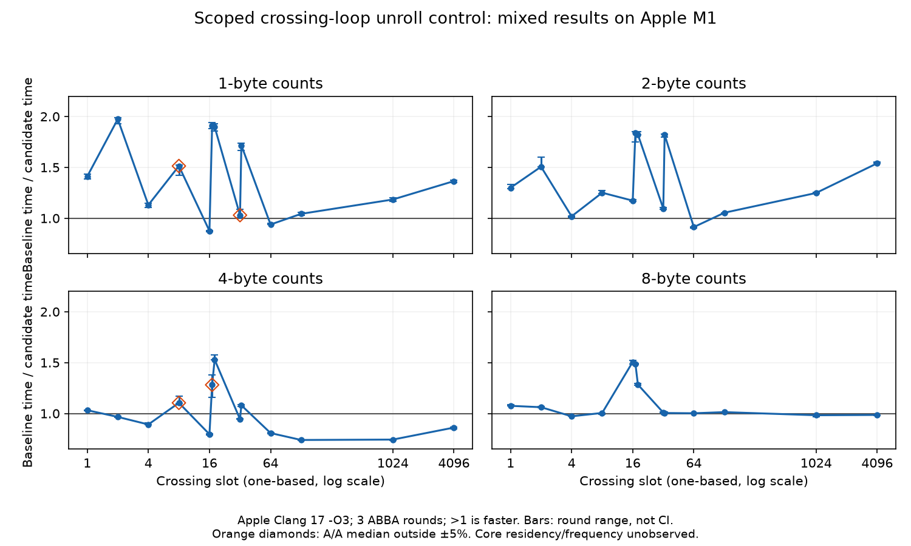

# macOS packed-scan pilot: SIMD restored, candidate rejected

2026-10-17. The user explicitly authorised a local Mac test for this investigation.
The one-line [candidate](candidate.patch) disables unrolling only inside the
packed single-percentile crossing resolver. It restores SIMD for narrow block
sums, but the measured trade-offs reject this exact candidate. No library branch,
submodule pointer, upstream PR or portable optimisation acceptance changed.



## Experimental context and limits

| Field | Recorded context |
| --- | --- |
| CPU | Apple M1, ARM64 hybrid; OS reports four performance and four efficiency cores. Fine-grained core implementation/residency was not measured. |
| Threads | One benchmark thread; machine reports eight physical/eight logical cores, no SMT exposed. |
| Frequency | Dynamic effective frequency and boost state unmeasured/uncontrolled. No core pinning. Requested and verified `QOS_CLASS_USER_INITIATED` (25). |
| Compiler | Apple Clang 17.0.0 (`clang-1700.6.3.2`), `-std=c99 -O3`; no LTO, fast-math or native tuning. Core dense/packed source objects compiled separately, log codec disabled. |
| Workload | Warm uniform-count packed histograms; count widths 1/2/4/8 bytes, populations 64/4096, 92 fixed crossing cases. Populated virtual indices are consecutive from zero. One fixed query per timed loop. |
| Baseline | Unchanged 0.12.1 `30e9ce6`; candidate changes only the crossing-loop pragma. Both link the exact same benchmark and dense object files. |
| Method | `CLOCK_MONOTONIC_RAW` wall time; 512 warmup calls per case; baseline-calibrated fixed iterations targeting 20 ms/case/run. Three ABBA rounds after three identical-binary A/A rounds. Case order reversed in the middle round. |

The numeric observations below describe this local pilot, not frequency-controlled
CPU throughput or a general library speedup. The CPU MCP evidence audit identifies
missing microarchitecture/frequency detail; do not turn these observations into a
qualified cross-machine claim. No hardware counters, energy measurements or fleet
replication were collected.

The predeclared A/A noise screen required at least 80% of cases' median ratios
within 5% of one; 81/92 passed. This permits looking for large effects, not the
workspace's tighter optimisation acceptance claim. All 11 noisy-control cases
remain in the data; none was trimmed. There were no extra timing rounds after
seeing the candidate results.

## Observations

Ratios are baseline time / candidate time: greater than one means the candidate
was faster. For each quartet, the two A times and two B times are geometrically
averaged; the reported ratio is the median of the three quartet ratios. Times
are the medians of the corresponding three paired time estimates. Ranges below
are the observed three-round ranges, **not confidence intervals**.

Selected cases from the 4096-slot fixture, with zero-based crossing positions:

| Count width | Crossing | Baseline ns/call | Candidate ns/call | Median ratio | Round range |
| --- | ---: | ---: | ---: | ---: | --- |
| 1 byte | 4095 | 453.59 | 332.57 | 1.365 | 1.351–1.376 |
| 2 bytes | 4095 | 450.38 | 291.80 | 1.540 | 1.540–1.553 |
| 4 bytes | 4095 | 235.13 | 273.00 | 0.861 | 0.849–0.867 |
| 8 bytes | 4095 | 1871.23 | 1895.55 | 0.986 | 0.979–0.996 |
| 1 byte | 15 | 9.48 | 10.83 | 0.876 | 0.869–0.881 |
| 2 bytes | 63 | 13.44 | 14.68 | 0.914 | 0.903–0.916 |
| 4 bytes | 1023 | 61.81 | 83.12 | 0.743 | 0.737–0.748 |

These examples show both long-scan gains and material regressions. The A/A
median ratios for the three final regression examples were 0.987, 1.004 and
0.999 respectively. Their candidate regressions persist in all three rounds.
All cases, including both populations, are in [ab/cases.csv](ab/cases.csv);
the same-binary controls are in [aa/cases.csv](aa/cases.csv).

The eight-byte source loop did not change, yet some short width-8 cases also
move substantially. This is not a machine-code-identical control: the common
function prologue changes from a 112-byte frame saving many registers to a
64-byte frame with fewer saves. That can affect every width. Attributing all
timing differences solely to SIMD would therefore be wrong.

## What the experiment establishes

- The narrow, single-loop pragma suffices to restore the SIMD block sums;
  global no-unroll flags are unnecessary for this code-generation effect.
  [Candidate remarks and assembly](codegen/) show SLP reductions for all three
  narrow widths. The [baseline assembly](../codegen/apple-clang-arm64-O3/hdr_packed_histogram.s)
  shows scalar byte/halfword sums and vector word sums.
- The exact candidate has unacceptable per-case trade-offs in this pilot.
  The four-byte path already had SIMD at baseline, and does not benefit from
  the same change. Widths 1/2 also have crossing-specific losses, so merely
  restricting the pragma to those widths would not establish an acceptable fix.
- A future design needs to keep exact crossing resolution efficient while
  decoupling the block sum. This result does not authorise another unbounded
  search. The next test should be a new, explicitly scoped hypothesis.

The candidate is **rejected for advancement**. The immutable dense write/read
referees and portable seven-lens acceptance review were not run: the candidate
already fails the pilot's regression checks. No acceptance counts changed.

## Correctness and provenance

Baseline and candidate passed CTest **9/9 each**:
[baseline](base-ctest.txt), [candidate](candidate-ctest.txt). The dedicated fixture
oracle checks every populated crossing against the dense histogram, plus p0
and p100: **16,640 + 16 checks** per validation. It passed for both binaries and
for the candidate under [ASan/UBSan](sanitizer-oracle.txt). Every timing process
also ran the oracle, and checked its accumulated result after each measurement.
Iteration counts and checksums match across all corresponding raw runs.

The baseline was measured before the candidate patch was created. Binary and
plan SHA-256 values, UTC run timestamps and case orders are saved in
[A/A provenance](aa/provenance.json) and [A/B provenance](ab/provenance.json).
The same baseline executable was used in both phases. No concurrent benchmark
or compilation was launched during timing. Unrelated workstation activity was
not controlled or sampled.

## Reproduction

Local timings require the user's scoped permission; otherwise use the fleet.
Export the pinned release for baseline measurement, and create/apply
`candidate.patch` to a second export only after that measurement. Compile
`scan_bench.c` and `hdr_histogram.c` once and each copy of
`hdr_packed_histogram.c` separately. Link each packed object with the identical
benchmark/dense objects and `-lm`. The benchmark is specific to macOS QoS/timer
APIs and must be adapted and revalidated before use on Linux.

```sh
# For each source object, use the same baseline include directories:
clang -std=c99 -O3 -I"$hdr_source/include" -I"$hdr_source/src" -c scan_bench.c -o bench.o
clang -std=c99 -O3 -I"$hdr_source/include" -I"$hdr_source/src" -c "$hdr_source/src/hdr_histogram.c" -o dense.o
clang -std=c99 -O3 -I"$hdr_source/include" -I"$hdr_source/src" -c "$hdr_source/src/hdr_packed_histogram.c" -o packed-base.o
clang bench.o dense.o packed-base.o -lm -o base
./base validate
./base calibrate > plan.csv
python3 run_pairs.py --a ./base --b ./base --plan plan.csv --out "$hdr_results/aa" --phase aa
# After a passing baseline screen, create the candidate export and apply the patch.
clang -std=c99 -O3 -I"$hdr_source/include" -I"$hdr_source/src" -c "$hdr_candidate/src/hdr_packed_histogram.c" -o packed-candidate.o
clang bench.o dense.o packed-candidate.o -lm -o candidate
./candidate validate
python3 run_pairs.py --a ./base --b ./candidate --plan plan.csv --out "$hdr_results/ab" --phase ab
```

Fresh result directories are required; the runner refuses overwrites and gates
A/B on a passing A/A for the exact baseline hash and plan. The historical
sequence measured A/A before creating the candidate, as recorded above; on a
new experiment preserve that order. `plot_results.py` requires matplotlib and
renders the committed CSV without rerunning any benchmark. CTest was run from
each build directory because the installed CTest 3.19 predates `--test-dir`.
